

# Codebase Onboarding Agent

**Stop guessing where a codebase starts. Build an evidence-backed map first.**

A Python CLI that inspects a local project or public GitHub repository and writes a beginner-friendly Markdown onboarding report. Static mode needs no model or API key. An optional OpenAI-compatible model can add a source-grounded explanation.

**Quick start** · **Architecture** · **AI setup** · **Security** · **Limitations**

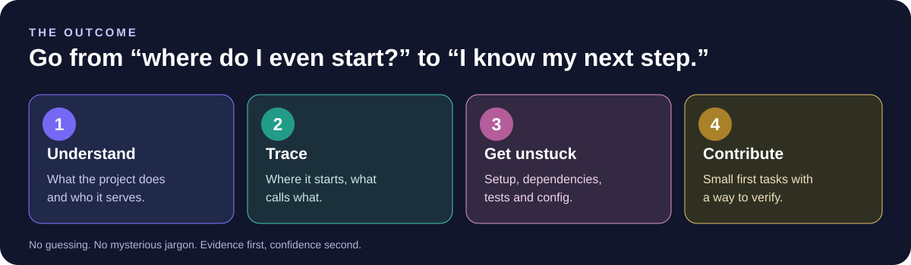

## The problem

You open a repository for the first time. The file tree is unfamiliar. The README explains the goal, but not where execution begins, which files matter, or how the pieces relate.

Codebase Onboarding Agent is an installable Python command-line tool designed to reduce that first-hour friction for students, open-source contributors, and developers joining an unfamiliar project.

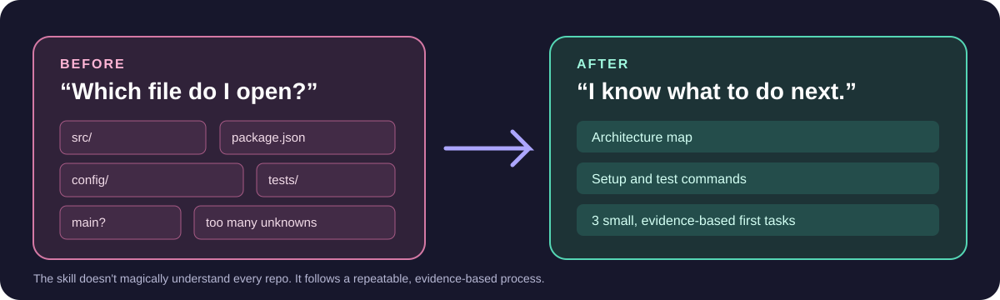

## What it does

Give it a local folder or a public GitHub repository URL. It inspects readable files and writes a report with:

- A repository file map and a structural architecture overview.
- Likely entry points with evidence and confidence labels.
- Python functions and classes extracted using Python's syntax tree.
- Dependencies and command scripts declared in supported manifests.
- Setup and test command references found in documentation/configuration, clearly marked as unverified.
- Small first-contribution ideas, skipped paths, and explicit limitations.
- Optional model-generated explanation when you explicitly enable it.

Static analysis is deliberately conservative. A file named app.py is a clue, not proof it is the actual startup path. A dependency in a manifest is a declaration, not proof that its code is used. A test file is not evidence that tests pass.

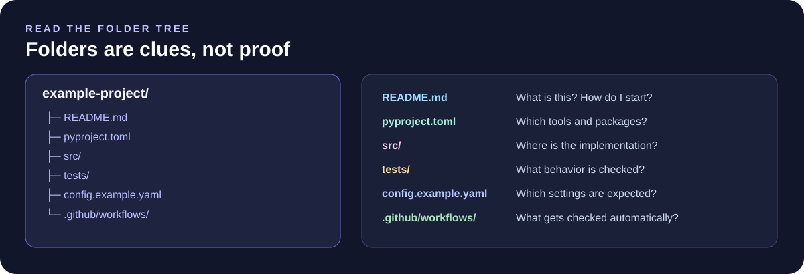

## Quick start

**Prerequisite:** Python 3.11 or newer.

### 1. Download the repository

Clone or download the source from https://github.com/yerageracharan/codebase-onboarding-agent and open a terminal in the project folder.

### 2. Install the package and test tools

~~~bash
python -m pip install -e ".[test]"
~~~

### 3. Analyze a local project

From the folder of the project you want to understand:

~~~bash
codebase-onboard . --output onboarding-report.md --static-only
~~~

Or pass a path directly:

~~~bash
codebase-onboard "C:\path\to\your-project" --output onboarding-report.md
~~~

The report is written to the output path. Static mode needs no model configuration and does not execute files from the target project.

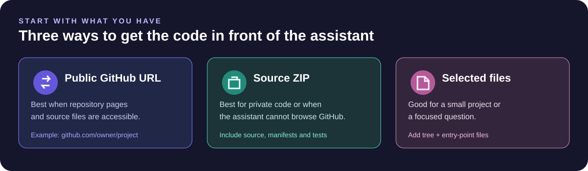

### 4. Analyze a public GitHub repository

~~~bash
codebase-onboard https://github.com/OWNER/REPOSITORY --output onboarding-report.md
~~~

Only a repository-root URL is supported. The CLI downloads a public ZIP archive with size and extraction limits. It does not currently pin a branch or commit and does not support private repositories, individual file URLs, or repository subpaths. Network access is required for this mode.

### 5. Check command options

~~~bash
codebase-onboard --help
codebase-onboard --version
~~~

The default output path is onboarding-report.md. Parent directories for the output file are created when needed.

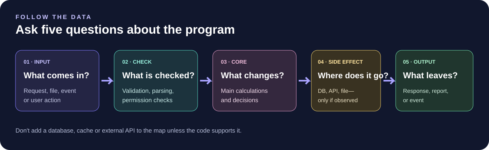

## Architecture map

The CLI is an actual Python package; it does not need an Agent Skill to run.

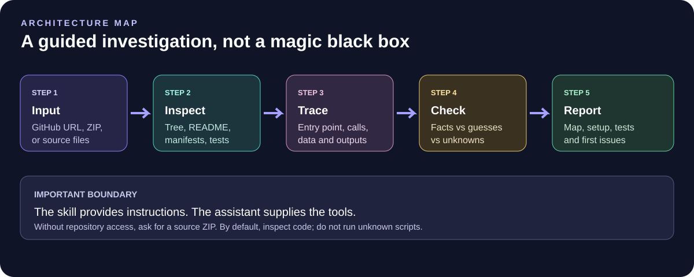

The main execution flow:

~~~text
Local directory or public GitHub URL
  -> source validation / bounded ZIP extraction
  -> safe file discovery and secret redaction
  -> manifest parsing and Python AST symbol extraction
  -> entry-point candidates and evidence inventory
  -> Markdown report
  -> optional AI interpretation when explicitly requested
~~~

~~~mermaid
flowchart TD
    A["Local folder or public GitHub URL"] --> B["repository.py"]
    B --> C["inventory.py + security.py"]
    C --> D["entrypoints.py"]
    C --> E["analysis.py"]
    D --> E
    E --> F["report.py"]
    C --> G{"--with-ai?"}
    G -- "No; default" --> F
    G -- "Yes; configured endpoint" --> H["llm.py"]
    H --> F
    F --> I["Markdown report"]
~~~

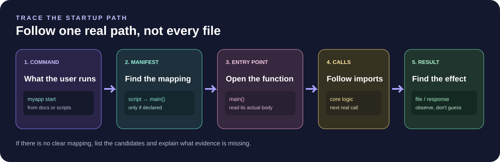

## What each module does

| Module | Responsibility |
|---|---|
| src/codebase_onboarding_agent/cli.py | Parses CLI arguments, selects mode, writes the report, and returns useful exit codes. |
| repository.py | Validates a local directory or public GitHub root URL; bounds ZIP download and extraction. |
| security.py | Excludes common sensitive files and generated directories; redacts selected secret-like patterns. |
| inventory.py | Builds a bounded text inventory, parses supported manifests, and extracts Python symbols. |
| entrypoints.py | Detects manifest script declarations, Python main guards, and labelled filename heuristics. |
| analysis.py | Connects file inventory and entry-point detection into an analysis result. |
| llm.py | Sends bounded, redacted excerpts to a user-configured OpenAI-compatible chat-completions endpoint. |
| report.py | Renders evidence and optional model interpretation as Markdown. |

## What files does it understand?

The scanner focuses on bounded, readable text files and common project metadata:

- Python: pyproject.toml and requirements*.txt.
- JavaScript/Node: package.json dependencies and script declarations.
- Rust: Cargo.toml dependency declarations.
- Go: go.mod dependency lines.
- Common documentation, tests, CI workflows, configuration, and source files in several languages.

Python classes, functions, async functions, and line ranges come from Python's built-in AST parser. For other languages, entry-point checks are based on available manifest evidence or explicitly labelled filename hints. The tool does not claim full semantic understanding of every language.

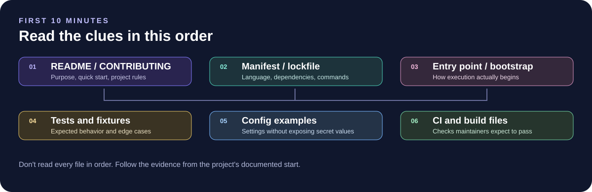

Default scanning bounds are 1,500 files, 300 KB per file, and 6 MB total text. The report lists skipped items and reasons where available.

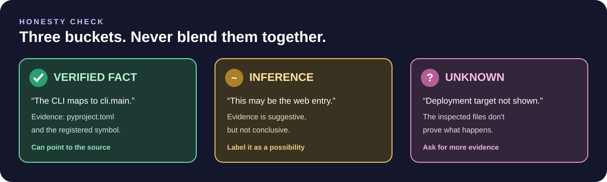

## Optional AI-enhanced analysis

Static-only mode is the default. To enhance a report, configure an OpenAI-compatible chat-completions endpoint. This may be a local model server such as Ollama or LM Studio, or a hosted provider offering a compatible endpoint.

Environment variables:

- CODEBASE_AGENT_BASE_URL — base API URL, for example http://localhost:11434/v1.
- CODEBASE_AGENT_MODEL — the exact model name served by your endpoint.
- CODEBASE_AGENT_API_KEY — optional for local servers; set it when your provider requires an API key.

### Windows PowerShell example

~~~powershell
$env:CODEBASE_AGENT_BASE_URL = "http://localhost:11434/v1"
$env:CODEBASE_AGENT_MODEL = "your-installed-model-name"
codebase-onboard . --with-ai --output onboarding-report.md
~~~

### macOS/Linux example

~~~bash
export CODEBASE_AGENT_BASE_URL="http://localhost:11434/v1"
export CODEBASE_AGENT_MODEL="your-installed-model-name"
codebase-onboard . --with-ai --output onboarding-report.md
~~~

Use the exact model name your local server exposes. This tool does not download a model or claim that your endpoint is running. Hosted services may require CODEBASE_AGENT_API_KEY. If your base URL already ends in /chat/completions, it is used as-is; otherwise the client appends /chat/completions.

AI mode sends selected, bounded, redacted text excerpts from the analyzed repository to your configured endpoint. Do not use it with private or confidential source unless you are authorized to share that source with the provider. An AI-generated explanation is an interpretation, not ground truth. Review claims against the file paths and line numbers in the report.

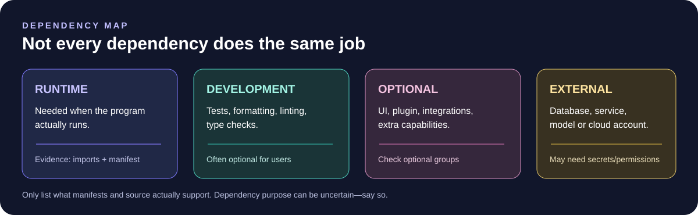

## Setup and tests: evidence, not assumptions

The tool reports command references it finds in documentation and common configuration files. It does not automatically install dependencies, run the project's setup, execute repository scripts, or run the target project's tests.

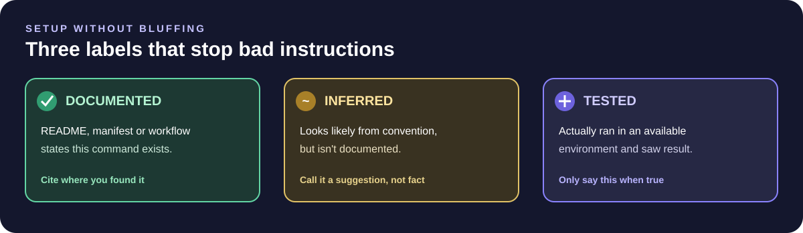

The distinction matters: a command written in a README is evidence of what the author documented, not proof that the command works in the current environment.

## Tests

Run the tool's tests from this repository:

~~~bash
python -m pip install -e ".[test]"
python -m pytest -q
~~~

The tests use temporary synthetic projects and mocked model/network responses. They do not require a paid model API, do not execute test code inside the target repository, and do not prove live GitHub or every model provider is compatible.

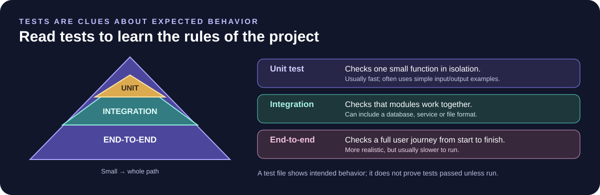

Continuous integration is configured in .github/workflows/tests.yml for Python 3.11, 3.12, and 3.13.

## Reproducible example run and screenshots

A repeatable verification workflow installs the CLI, analyzes the included Tiny Taskboard project, captures the generated report, runs the agent tests and sample project tests separately, and publishes screenshots of the actual output. See the [verification walkthrough and screenshot gallery](examples/verification/README.md). The workflow does not call a real model provider or execute target code as part of analysis.

## First contributions

Good next improvements are small, verifiable changes: add tests for an additional manifest format, improve a false-positive entry-point heuristic, expand secret-pattern tests, or improve report readability for one supported language.

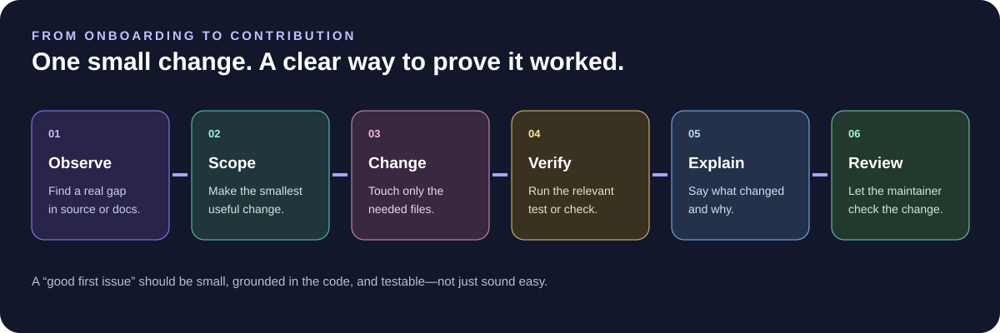

Do not label suggestions as existing GitHub issues unless the issue tracker was checked. Keep pull requests scoped and include a reproducible test.

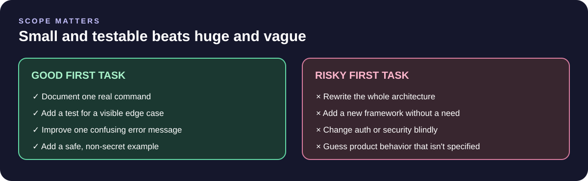

## Security and privacy

Repository contents are untrusted data. Source files may contain malicious instructions, confidential configuration, or commands that should never run automatically.

The analyzer:
- Never executes the source code, scripts, install commands, or tests of the repository being analyzed.
- Skips common generated folders such as .git, virtual environments, node_modules, build, and dist.
- Excludes dotenv and common credential/private-key files.
- Redacts several common secret-like patterns before inventory/report/model use.
- Bounds file count, file size, total text, archive size, archive entry count, extraction size, and model context.
- Rejects unsafe ZIP paths and skips symlink entries during public-repository extraction.

These are layered protections, not a guarantee that every secret can be detected. Review reports and any AI-bound source context before using this tool on sensitive material.

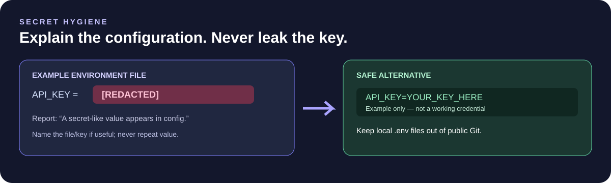

## What a report looks like

The report includes source and mode, scanned/skipped file counts, a repository map, important files, likely entry points, Python symbols, manifest dependency evidence, setup/test command references, suggested first contributions, and unknowns.

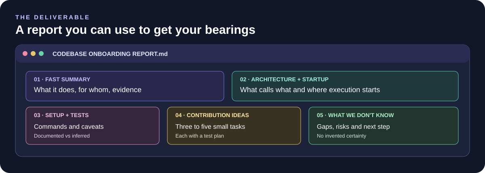

A static report will not invent a project purpose from the name alone. When AI mode is enabled, a separate interpretation section identifies model-generated explanations and reminds the reader to verify claims. In both modes, the tool is explicit that it did not run the target project.

## Installation options

The CLI is the primary runnable product. The Agent Skill is optional and can help a compatible AI assistant explain a repository using the same evidence-first approach; a skill file alone is not a Python CLI or a runtime service.

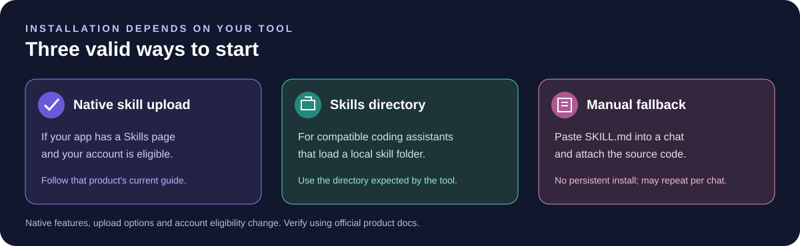

To run the CLI, install this Python package in an environment where you have permission to install packages. To use the optional skill, follow the instructions for your chosen assistant and check that the product/plan/workspace supports custom skills. Do not assume a skill is installed just because the repository contains SKILL.md.

## Quality checklist and known boundaries

Before relying on a report, check that the source URL/path is correct, inspect the high-confidence entry points, validate any proposed setup commands, and compare AI explanations to source evidence.

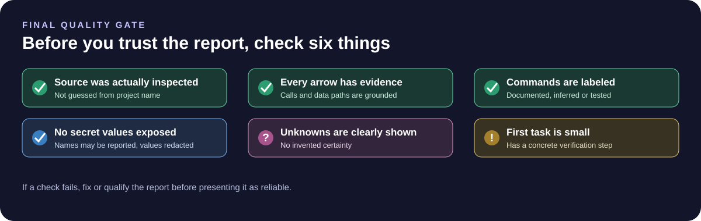

Known boundaries:

- Private GitHub repositories are not supported by the built-in downloader.
- Public GitHub archives are downloaded without a pinned commit or branch.
- The analyzer is static and does not prove actual runtime behavior.
- Entry point candidates can include heuristics; they are labelled as such.
- Dependency extraction is manifest-based and not a complete lockfile or transitive dependency resolver.
- Secret detection is pattern-based and may miss sensitive values.
- Model compatibility depends on the endpoint's OpenAI-compatible response format.
- Model output may be wrong and requires human review.
- Tests of this tool do not prove the target repository works.

## Troubleshooting

**The command is not found after install.** Close and reopen the terminal, check that the intended Python environment is active, then try python -m codebase_onboarding_agent --help.

**GitHub download fails.** Confirm the repository is public and that you supplied exactly https://github.com/OWNER/REPOSITORY. Network access is required.

**AI mode says it is not configured.** Set both CODEBASE_AGENT_BASE_URL and CODEBASE_AGENT_MODEL. CODEBASE_AGENT_API_KEY is optional only when your endpoint does not require authentication.

**The model endpoint returns an error.** Confirm its URL, model name, authentication settings, and OpenAI-compatible chat-completions support. Static-only mode remains available.

**The report seems too certain.** Treat model-generated analysis as a hypothesis and request the exact file/line evidence. The scanner can describe static evidence; it cannot verify behavior it did not execute.

## Try it on the included toy project

The included examples/toy-python-project directory is intentionally synthetic and small. Run the CLI against it:

~~~bash
codebase-onboard examples/toy-python-project --output toy-onboarding-report.md
~~~

The report is generated from the files on disk. It is not a prerecorded claim that a target project's tests passed.

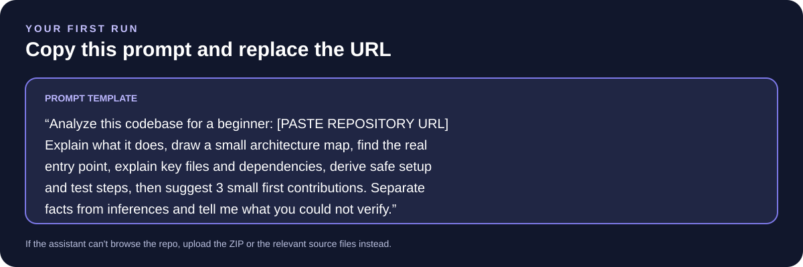

## Project structure

~~~text
src/codebase_onboarding_agent/
  cli.py          Command-line interface
  config.py       Optional model configuration
  repository.py   Local paths and public GitHub ZIP retrieval
  security.py     Exclusions and redaction
  inventory.py    File discovery, manifests, Python AST
  entrypoints.py  Entry-point evidence
  analysis.py     Deterministic analysis orchestration
  llm.py          Optional OpenAI-compatible model request
  report.py       Markdown report renderer

tests/             Automated tests using synthetic repositories
examples/          Small toy repository and sample report
assets/            README visuals
SKILL.md           Optional assistant instruction skill
~~~

## Contributing

Open a focused issue or pull request. Include the behavior you are changing, the evidence behind it, and a reproducible test. Please do not add actual secrets, private source code, or fabricated report output.

## License

MIT. See LICENSE.

---

**Day 03 / 200.** Don't learn a codebase by guessing. Build the map, check the evidence, then make the change.
