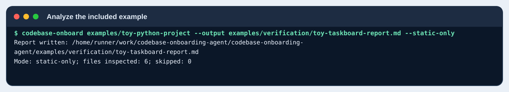
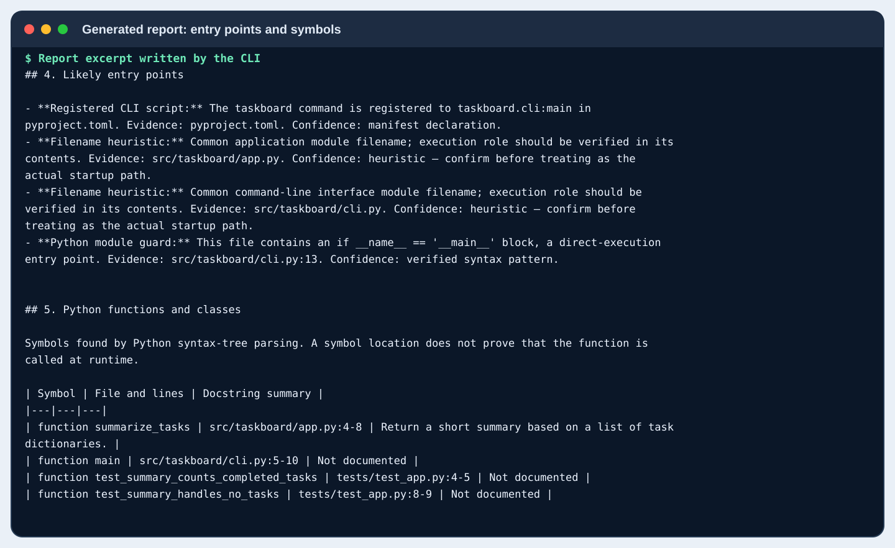
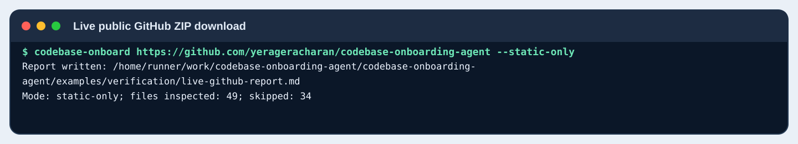
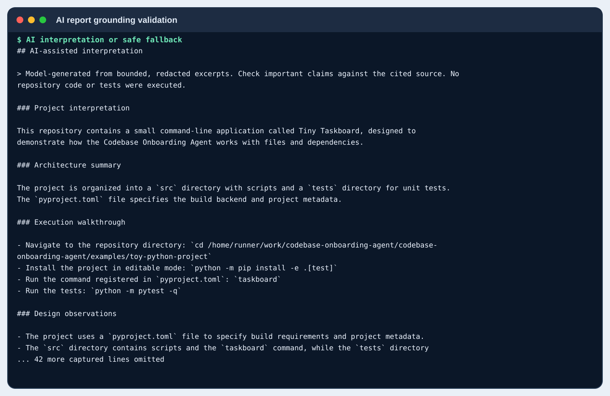

<h1>Codebase Onboarding Agent</h1>

<strong>Understand an unfamiliar codebase before you change it.</strong>

A Python CLI that scans local projects or public GitHub repositories and creates an evidence-backed onboarding report.

  
  
  
  

  <a href="#quick-start">Quick start</a> ·
  <a href="#use-cases">Use cases</a> ·
  <a href="#verified-run-screenshots">Screenshots</a> ·
  <a href="examples/reports/sample-onboarding-report.md">Example report</a> ·
  <a href="#repository-map">Project map</a> ·
  <a href="#security-and-limitations">Security &amp; limits</a>

---

## What it does

Starting in a new repository can mean guessing which file matters, how a program starts, which libraries are actually declared, and where a beginner-sized change might fit. This tool builds a **static evidence map first** rather than inventing a runtime architecture.

Given a local directory or a supported public GitHub repository URL, it can produce a Markdown report containing:

- **Repository map:** readable files and paths skipped by the scanner, with reasons.
- **Entry-point evidence:** manifest-declared CLI scripts, Python main guards, and clearly labelled filename heuristics.
- **Python symbols:** functions, classes, async functions, docstrings, and source line ranges parsed from Python's AST.
- **Dependency evidence:** dependency declarations and command scripts found in supported manifests.
- **Setup and test references:** commands found in documentation and configuration, explicitly distinguished from commands executed by the analyzer.
- **First-contribution ideas:** small, file-specific suggestions with a way to verify them.
- **Optional AI interpretation:** a model can explain selected redacted excerpts. Deterministic checks remove specific detectable contradictions and the CLI falls back to static-only output if no AI content survives.

## Quick start

**Requirements:** Python 3.11 or newer.

### 1. Install

From the repository root:

~~~bash
python -m pip install -e ".[test]"
~~~

### 2. Analyze a local project

~~~bash
codebase-onboard ./path/to/project --output onboarding-report.md --static-only
~~~

For the included example:

~~~bash
codebase-onboard examples/toy-python-project --output toy-onboarding-report.md --static-only
~~~

### 3. Analyze a public GitHub repository

~~~bash
codebase-onboard https://github.com/OWNER/REPOSITORY --output onboarding-report.md --static-only
~~~

The built-in downloader currently accepts **public repository-root URLs only**. It does not support private repositories, branch or commit URLs, individual files, or subdirectories. The downloaded ZIP is bounded by size and extraction limits and is not pinned to a specific commit.

### 4. Inspect the generated report

Open <code>onboarding-report.md</code>. It includes the detected file tree, structural inventory, likely entry points, Python symbols, manifest evidence, setup/test references, possible first contributions, and explicit limitations.

For a grounded example based on the included Tiny Taskboard project, see the [sample onboarding report](examples/reports/sample-onboarding-report.md). It is a synthetic example, not an analysis of an external production repository.

## Use cases

| Use case | What the agent helps with | Start here |
|---|---|---|
| **First contribution to open source** | Locate the documented command, likely startup files, functions and tests before choosing a small issue. | [Entry points and symbols screenshot](examples/verification/screenshots/05-entry-points-symbols.svg) |
| **Students learning an unfamiliar project** | Turn a large or unfamiliar file tree into a concise map and a suggested investigation sequence. | [Tiny Taskboard source example](examples/toy-python-project/) |
| **Repository handover or onboarding** | Produce a repeatable Markdown overview that a teammate can review alongside source evidence. | [Sample report](examples/reports/sample-onboarding-report.md) |
| **Pre-review investigation** | Find manifest declarations, test paths, setup instructions and areas that need owner confirmation before changing code. | [Static analysis screenshot](examples/verification/screenshots/02-analysis-command.svg) |
| **AI-assisted explanation with guardrails** | Use a configured OpenAI-compatible endpoint for plain-English interpretation, with deterministic filters for certain detectable contradictions. | [AI grounding validation screenshot](examples/verification/screenshots/12-ai-grounding-validation.svg) |

This is an onboarding aid, not a replacement for reading code, confirming requirements with maintainers, or running appropriate tests in a trusted development environment.

## Verified run screenshots

The screenshots below are generated from saved CLI output and the Markdown reports produced by the verification workflow. The terminal-style images are **rendered captures**, not photographs or recordings of a physical desktop. Select an image to open the full-size version.

<table>
  <tr>
    <td width="50%" valign="top">
      
      <strong>1. Static analysis</strong> 
      The CLI writes a report after scanning the six readable files in the synthetic project.
    </td>
    <td width="50%" valign="top">
      
      <strong>2. Source map</strong> 
      Manifest evidence, the registered command and AST-detected Python symbols are kept distinct from runtime assumptions.
    </td>
  </tr>
  <tr>
    <td width="50%" valign="top">
      
      <strong>3. Live public GitHub download</strong> 
      The workflow downloads this public repository and runs static report generation against that archive.
    </td>
    <td width="50%" valign="top">
      
      <strong>4. AI report checks</strong> 
      The real local-model run produced an AI-enhanced report and removed three claims that conflicted with scanned evidence.
    </td>
  </tr>
</table>

For all captures, raw logs and generated reports, see the [verification evidence index](examples/verification/README.md).

## Example: what the report can show

The included synthetic project, **Tiny Taskboard**, is deliberately small. Its <code>pyproject.toml</code> declares the <code>taskboard</code> command as <code>taskboard.cli:main</code>. The CLI calls <code>summarize_tasks()</code> from <code>src/taskboard/app.py</code>. The sample output is:

~~~text
1 of 2 tasks completed
~~~

The sample project has two tests, covering a completed-task count and an empty list. They are run as a separate step in verification; the analyzer itself does not execute target code or tests.

- [Read the example project's source](examples/toy-python-project/)
- [Read the sample onboarding report](examples/reports/sample-onboarding-report.md)
- [Read the most recent AI-enhanced report](examples/verification/toy-taskboard-ai-report.md)
- [Read the live GitHub analysis report](examples/verification/live-github-report.md)

## Optional AI mode

Static-only mode is the default and makes no model API calls. AI mode is opt-in and requires an already-running OpenAI-compatible chat-completions endpoint, such as local Ollama or LM Studio.

### Windows PowerShell

~~~powershell
$env:CODEBASE_AGENT_BASE_URL = "http://localhost:11434/v1"
$env:CODEBASE_AGENT_MODEL = "your-installed-model-name"
codebase-onboard . --with-ai --output onboarding-report.md
~~~

### macOS / Linux

~~~bash
export CODEBASE_AGENT_BASE_URL="http://localhost:11434/v1"
export CODEBASE_AGENT_MODEL="your-installed-model-name"
codebase-onboard . --with-ai --output onboarding-report.md
~~~

Set <code>CODEBASE_AGENT_API_KEY</code> only if your provider requires it. The model must already be available through the endpoint; the CLI does not download models.

**Privacy:** AI mode sends selected, bounded, redacted source excerpts to the endpoint you configured. Do not use it on confidential repositories unless you are authorized to share those excerpts with that provider.

### How grounding checks work

The deterministic inventory remains the authority for discovered file paths, manifest facts, and Python symbol locations. The AI validation layer checks for a defined set of detectable contradictions, including missing-file claims, some symbol-to-file mismatches, and certain malformed or altered setup commands. It removes items that fail those checks and records why. If every model-generated item is rejected, the CLI writes a static-only report.

These checks are intentionally limited: they **do not prove every surviving explanation is true**. Review architecture claims against the cited files and confirm behavior through appropriate tests.

## Architecture

~~~mermaid
flowchart TD
    A["Local folder or public GitHub URL"] --> B["Validate source / bounded ZIP extraction"]
    B --> C["Discover readable files and redact selected secrets"]
    C --> D["Parse manifests and Python AST symbols"]
    D --> E["Build deterministic evidence inventory"]
    E --> F{"AI mode enabled?"}
    F -- "No" --> H["Render static report"]
    F -- "Yes" --> G["Configured model endpoint"]
    G --> I["Grounding consistency checks"]
    I --> H
    H --> J["Markdown onboarding report"]
~~~

The tool intentionally produces a **structural inventory**, not a verified runtime call graph. A filename such as <code>app.py</code> is a hint, not proof of an entry point. A declared dependency is evidence that it is listed, not proof that it is imported at runtime. A detected test file does not prove that its tests pass.

## Repository map

The directory index below labels **every directory in the repository tree** by purpose. Tags are short role labels; select a folder link to browse its files on GitHub.

| Directory | Tag | Contents |
|---|---|---|
| [<code>.github/</code>](.github/) | <kbd>Automation</kbd> | GitHub project automation and workflow configuration. |
| [<code>.github/workflows/</code>](.github/workflows/) | <kbd>CI / verification</kbd> | Python-version test matrix and the live end-to-end verification demo. |
| [<code>agents/</code>](agents/) | <kbd>Agent metadata</kbd> | Assistant interface configuration and default prompt. |
| [<code>assets/</code>](assets/) | <kbd>Branding</kbd> | Hero graphic used as the project visual and agent icon. |
| [<code>docs/</code>](docs/) | <kbd>Documentation hub</kbd> | Documentation index and detailed installation guide. |
| [<code>docs/assets/</code>](docs/assets/) | <kbd>Diagrams</kbd> | SVG diagrams used to explain workflows, architecture, safety and report structure. |
| [<code>docs/references/</code>](docs/references/) | <kbd>Reference guides</kbd> | Report template, investigation checklist and beginner contribution playbook. |
| [<code>examples/</code>](examples/) | <kbd>Examples index</kbd> | Directory index for the sample project, sample report and verification artifacts. |
| [<code>examples/reports/</code>](examples/reports/) | <kbd>Sample output</kbd> | Curated example onboarding report based on Tiny Taskboard. |
| [<code>examples/toy-python-project/</code>](examples/toy-python-project/) | <kbd>Synthetic fixture</kbd> | Small Python CLI project used to demonstrate the analyzer. |
| [<code>examples/toy-python-project/src/</code>](examples/toy-python-project/src/) | <kbd>Fixture source root</kbd> | Source-layout root for the Tiny Taskboard package. |
| [<code>examples/toy-python-project/src/taskboard/</code>](examples/toy-python-project/src/taskboard/) | <kbd>Fixture package</kbd> | Task-summary logic, CLI entry point and package initializer. |
| [<code>examples/toy-python-project/tests/</code>](examples/toy-python-project/tests/) | <kbd>Fixture tests</kbd> | Two tests for completed-task counting and empty input. |
| [<code>examples/verification/</code>](examples/verification/) | <kbd>Run evidence</kbd> | Captured logs, static and AI reports, model details and run metadata. |
| [<code>examples/verification/screenshots/</code>](examples/verification/screenshots/) | <kbd>Screenshot captures</kbd> | SVGs rendered from actual CLI output and generated report excerpts. |
| [<code>scripts/</code>](scripts/) | <kbd>Developer tooling</kbd> | Script that regenerates verification screenshot captures and metadata. |
| [<code>src/</code>](src/) | <kbd>Python source root</kbd> | Installable application source using the standard Python source-layout convention. |
| [<code>src/codebase_onboarding_agent/</code>](src/codebase_onboarding_agent/) | <kbd>Core package</kbd> | CLI, repository loader, inventory, security filters, AST analysis, AI client and report renderer. |
| [<code>tests/</code>](tests/) | <kbd>Automated tests</kbd> | Unit tests for repository handling, inventory, CLI and AI grounding checks. |

### Important root files

| File | Role |
|---|---|
| [<code>README.md</code>](README.md) | Project homepage, feature overview, setup, screenshots and links. |
| [<code>docs/installation.md</code>](docs/installation.md) | Extended installation and configuration instructions. |
| [<code>pyproject.toml</code>](pyproject.toml) | Package metadata, supported Python version, test dependency and CLI registration. |
| [<code>SKILL.md</code>](SKILL.md) | Optional assistant instruction skill; separate from the executable Python CLI. |
| [<code>LICENSE</code>](LICENSE) | MIT license. |
| [<code>.gitignore</code>](.gitignore) | Local environments, caches, build outputs and common generated files. |

## Project modules

| Module | Responsibility |
|---|---|
| <code>cli.py</code> | Parses command-line arguments, chooses static or AI mode, and writes the report. |
| <code>repository.py</code> | Validates local directories and retrieves supported public GitHub ZIP archives. |
| <code>security.py</code> | Excludes common sensitive paths and redacts selected secret-like patterns. |
| <code>inventory.py</code> | Builds a bounded text inventory, parses supported manifests and extracts Python symbols. |
| <code>entrypoints.py</code> | Finds declared entry points, Python main guards and labelled filename heuristics. |
| <code>llm.py</code> | Calls the configured model and validates defined classes of conflicting claims. |
| <code>report.py</code> | Renders evidence, model interpretation, warnings and limitations as Markdown. |

## Supported evidence

| Evidence source | Currently supported behavior |
|---|---|
| Python | Functions, async functions, classes and line ranges extracted with Python's AST parser. |
| <code>pyproject.toml</code> | Project metadata, dependency declarations, optional dependency groups, build backend and CLI scripts. |
| <code>package.json</code> | Package metadata, dependency groups and declared scripts. |
| <code>requirements*.txt</code> | Basic dependency-line extraction. |
| <code>Cargo.toml</code> | Dependency declarations. |
| <code>go.mod</code> | Common Go module dependency declarations. |
| Documentation and CI | Selected setup/test command references and workflow files. |

The scanner's default bounds are 1,500 files, 300 KB per file and 6 MB total source text. Only supported, readable text is analyzed; some paths are skipped for safety, size, format or exclusion rules.

## Tests and verification

Install the package and test tools, then run:

~~~bash
python -m pip install -e ".[test]"
python -m pytest -q
~~~

The test workflow runs on Python 3.11, 3.12 and 3.13. The separate verification workflow checks CLI help/version, static report generation, live download of this public repository, the included example's tests and command output, invalid-URL handling, and a real local Ollama request. Its outputs are committed under <code>examples/verification/</code> when the workflow succeeds.

- [Run the Python test matrix](https://github.com/yerageracharan/codebase-onboarding-agent/actions/workflows/tests.yml)
- [Run the live verification workflow](https://github.com/yerageracharan/codebase-onboarding-agent/actions/workflows/verification-demo.yml)
- [Read test-scope and verification limitations](examples/verification/README.md)

## Security and limitations

- The analyzer does not execute code, install scripts or run tests from the target repository.
- Static-only mode makes no model requests.
- The GitHub downloader currently supports public repository-root URLs only and does not pin a branch or commit.
- Secret detection and model-grounding checks are pattern-based and incomplete.
- Model-generated explanations can still contain semantic mistakes even after consistency filtering.
- The report is an aid to investigation; inspect source and run trusted tests before relying on claims about runtime behavior.

## Contributing

Prefer focused, evidence-backed changes. Add or update tests alongside behavior changes, keep example output labelled as synthetic or run-generated, and do not invent GitHub issues. See the [beginner contribution playbook](docs/references/beginner-issue-playbook.md) and [investigation checklist](docs/references/investigation-checklist.md).

## License

This repository is licensed under the [MIT License](LICENSE).
