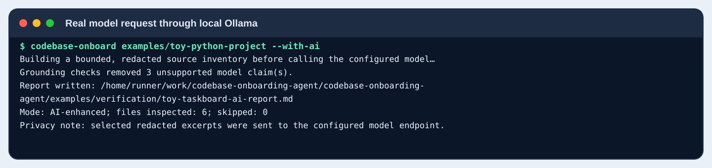

# Reproducible CLI verification

This directory is populated by the verification workflow. It tests the executable CLI against the included synthetic Tiny Taskboard project and the live public GitHub repository.

## What is tested

1. Installed CLI help and version commands.
2. Static-only analysis of the included Tiny Taskboard project.
3. Live public GitHub ZIP download of this repository, followed by static report generation.
4. The Codebase Onboarding Agent test suite.
5. Tiny Taskboard's two tests and demo CLI, run separately from analysis.
6. A real AI request to a locally hosted Ollama model (qwen2.5:1.5b) through the OpenAI-compatible /v1/chat/completions endpoint.
7. Deterministic checks against the AI response: contradictory claims are removed, and fully rejected output falls back to a static-only report.
8. Invalid repository URL rejection without a network request.

## Screenshots of the actual run

Each image is rendered from saved stdout/stderr or excerpts of the report files the CLI wrote. Terminal-style captures are not recordings of a physical desktop session.

### 1. CLI help

### 2. Analyze the included toy project

### 3. Generated static report: overview

### 4. Generated static report: architecture map

### 5. Generated report: entry points and Python symbols

### 6. Agent tests

### 7. Tiny Taskboard tests

### 8. Run the toy application

### 9. Invalid URL handling

### 10. Live public GitHub ZIP download

### 11. Real AI request through local Ollama

### 12. AI report grounding validation

The model is not treated as a source of truth. The report keeps model-generated explanations only when they pass the implemented consistency checks; detected contradictions are removed and reported, and if no usable model content remains the CLI writes a static-only report.

## Evidence files

- toy-taskboard-report.md — static report written from the included project.
- live-github-report.md — report written after downloading the public repository archive.
- toy-taskboard-ai-report.md — report produced after a real Ollama model request; the grounding validator may remove conflicting claims or use a static-only fallback.
- 01-version.txt and 02-help.txt — CLI output.
- 03-toy-run.txt, 04-live-github-run.txt, 10-ai-model-run.txt — actual CLI run summaries.
- 05-test-results.txt — agent test results.
- 06-toy-project-tests.txt and 07-toy-project-run.txt — separate sample tests and runtime output.
- 08-invalid-url.txt — validation error and exit code.
- 09-ollama-model.txt — provider/model/endpoint details.
- run-metadata.md — run scope and limits.

## Reproduce locally

Python 3.11 or newer is required. To reproduce live AI testing, install Ollama and download the same model first; that setup is optional for static use.

~~~bash
python -m pip install -e ".[test]"
codebase-onboard examples/toy-python-project --output examples/verification/toy-taskboard-report.md --static-only
python -m pytest -v
PYTHONPATH=examples/toy-python-project/src python -m pytest -v examples/toy-python-project/tests
PYTHONPATH=examples/toy-python-project/src python -m taskboard.cli
codebase-onboard https://github.com/yerageracharan/codebase-onboarding-agent --output examples/verification/live-github-report.md --static-only
ollama serve
ollama pull qwen2.5:1.5b
CODEBASE_AGENT_BASE_URL=http://127.0.0.1:11434/v1 CODEBASE_AGENT_MODEL=qwen2.5:1.5b codebase-onboard examples/toy-python-project --with-ai --output examples/verification/toy-taskboard-ai-report.md
python scripts/generate_verification_screenshots.py
~~~

The analyzer does not execute target source. Sample project tests and its runtime command are separate verification steps. Live GitHub testing requires network access; AI testing downloads/runs the selected local model. Grounding checks catch detectable path, file-absence, symbol-location, and metadata-attribution contradictions; they are not a proof of semantic correctness.

## Verification boundaries

A passing GitHub step verifies the current ZIP downloader against this public repository at run time, not every public repository or private repositories. A passing Ollama step verifies the request path with the tested model only; it does not imply every hosted provider or model is compatible.
