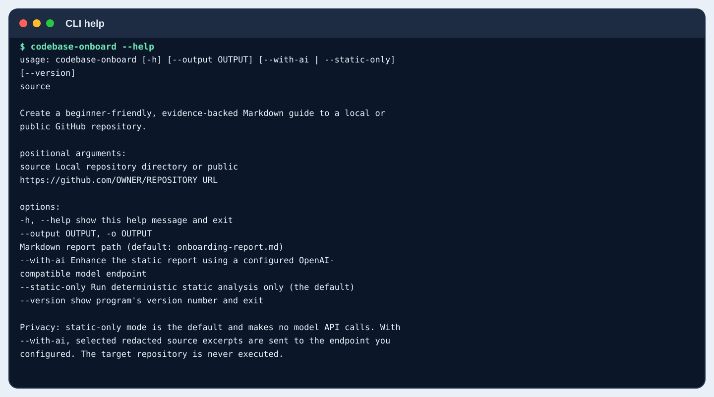
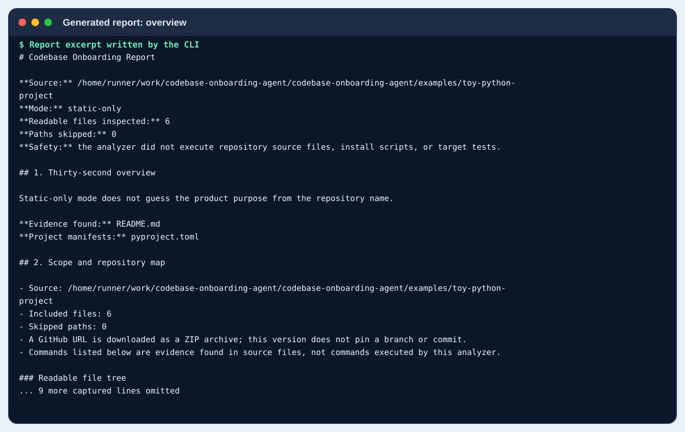
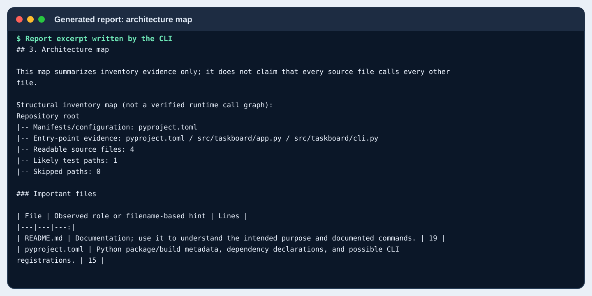
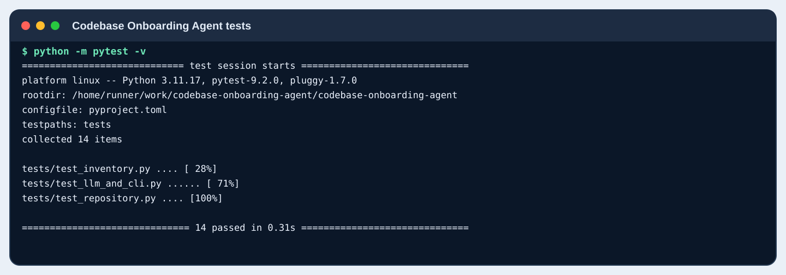
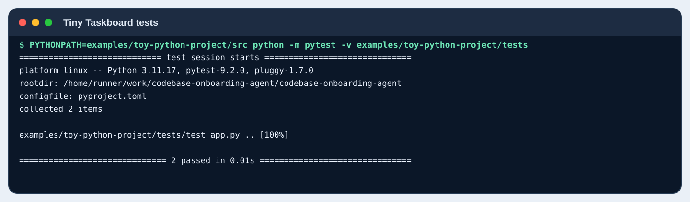
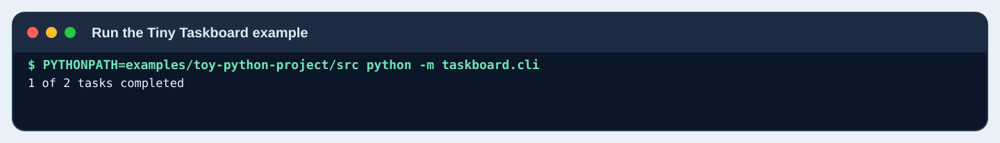
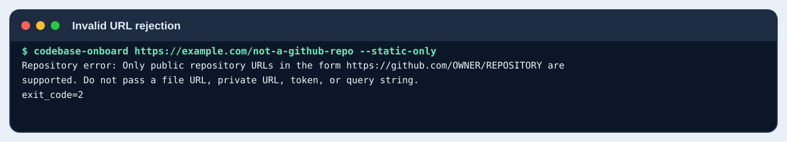

# Reproducible CLI verification

This directory is populated by [the verification workflow](../../.github/workflows/verification-demo.yml). It is intended to show what the executable CLI actually did against the included synthetic Tiny Taskboard project.

## What is tested

1. The installed CLI's help and version commands.
2. A real static-only CLI run against `examples/toy-python-project`, writing `toy-taskboard-report.md`.
3. A rendered view of the generated report's overview, architecture, entry points, and Python symbols.
4. The Codebase Onboarding Agent test suite, run separately from the target project tests.
5. The Tiny Taskboard example's two tests and its demo CLI, run separately as an explicit verification step.
6. Rejection of an invalid repository URL without any network request.

## Screenshots of the actual run

Each image below is generated from saved stdout/stderr or from a section of the report that the CLI wrote. Terminal-style screenshots retain real captured output; report screenshots display real report excerpts.

### 1. CLI help



### 2. Run the agent against the included example


### 3. Generated report: overview and file map



### 4. Generated report: architecture map



### 5. Generated report: entry points and Python symbols


### 6. Codebase Onboarding Agent automated tests



### 7. Tiny Taskboard example tests



### 8. Run the Tiny Taskboard example CLI



### 9. Invalid URL handling



## Evidence files

- [Generated onboarding report](toy-taskboard-report.md)
- [CLI version output](01-version.txt)
- [CLI help output](02-help.txt)
- [Agent CLI execution output](e03-toy-run.txt)
- [Agent test results](05-test-results.txt)
- [Toy example test results](06-toy-project-tests.txt)
- [Toy example runtime output](07-toy-project-run.txt)
- [Invalid URL validation and exit code](08-invalid-url.txt)
- [Run metadata and verification limits](run-metadata.md)

## Reproduce locally

From the repository root with Python 3.11+:

```bash
python -m pip install -e ".[test]"
codebase-onboard --version
codebase-onboard --help
codebase-onboard examples/toy-python-project --output examples/verification/toy-taskboard-report.md --static-only
python -m pytest -v
PYTHONPATH=examples/toy-python-project/src python -m pytest -v examples/toy-python-project/tests
PYTHONPATH=examples/toy-python-project/src python -m taskboard.cli
python scripts/generate_verification_screenshots.py
```

Static-only mode does not configure or call a model. The analyzer itself never executes the target repository; the sample app tests and runtime command above are run separately by the verification workflow because Tiny Taskboard is a small synthetic, included project.

## Boundaries

The workflow does not make a live public GitHub download or connect to a real model provider. Do not describe those integrations as live-verified based solely on these screenshots.
